# LokerDekat

**Website info loker yang mengurutkan lowongan dari yang paling dekat ke lokasi pengguna.**<br>
*Lengkap dengan peta lokasi, divisi yang lowong, dan daftar loker favorit — khusus pencari kerja di Kota Probolinggo.*

[](https://lokerdekat.rf.gd/loker/) [](https://github.com/muhammadhabibullah59924-hub/loker/actions/workflows/ci.yml) [](LICENSE) [](https://laravel.com) [](https://www.php.net) [](https://www.mysql.com) [](https://getbootstrap.com) [](https://leafletjs.com) [](phpunit.xml)

[Live Website](https://lokerdekat.rf.gd/loker/) · [Panduan Penggunaan](docs/PANDUAN_PENGGUNAAN.md) · [PRD](docs/PRD.md) · [Deploy](DEPLOY.md) · [Arsitektur](docs/ARCHITECTURE.md)

---

## Ringkasan Proyek

Anak muda di Probolinggo sering hanya mengikuti grup lowongan tanpa tahu ke mana harus melangkah dan mana yang benar-benar bisa didatangi. **LokerDekat** menyajikan lowongan yang **diurutkan dari yang paling dekat** ke lokasi pengguna, lengkap dengan nama PT, alamat jalan, divisi yang lowong, dan peta lokasi.

- **Fokus:** informasi lowongan, bukan lamaran. Tidak ada fitur unggah CV.
- **Data:** seluruh loker bersifat **fiktif** hasil seeder untuk demonstrasi.
- **Privasi:** koordinat lokasi pengguna hanya dipakai selama sesi untuk menghitung jarak dan **tidak disimpan ke basis data**.
- **Pengguna:** pencari kerja (melihat, mencari, menyimpan favorit) dan pengelola (mengelola katalog loker lewat panel admin).

---

## Tampilan Aplikasi

### Antarmuka Pencari Kerja

| | |
|---|---|
| [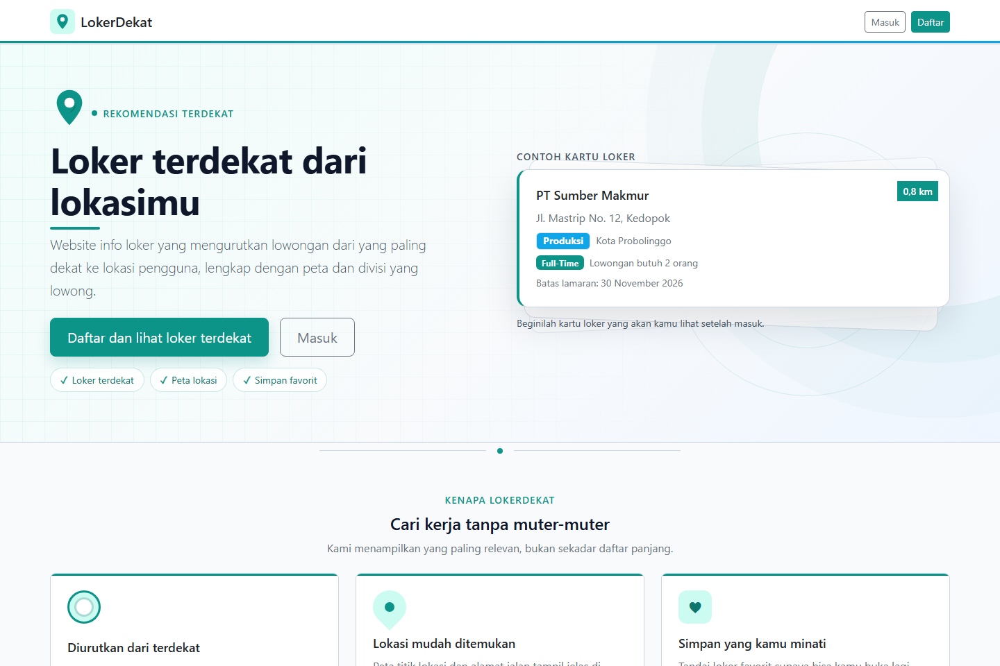](docs/screenshots/landing.png) **1. Halaman depan (F2, R3)** — hero, contoh kartu loker, keunggulan, dan panduan tiga langkah: izinkan lokasi → lihat urutan terdekat → buka detail. | [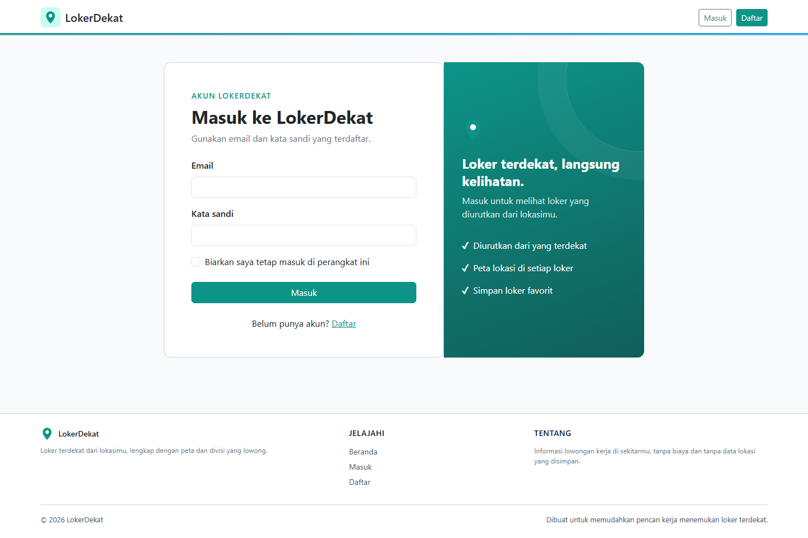](docs/screenshots/login.png) **2. Masuk / daftar (F1)** — kartu form di kiri dan panel gradien berisi keunggulan di kanan. |
| [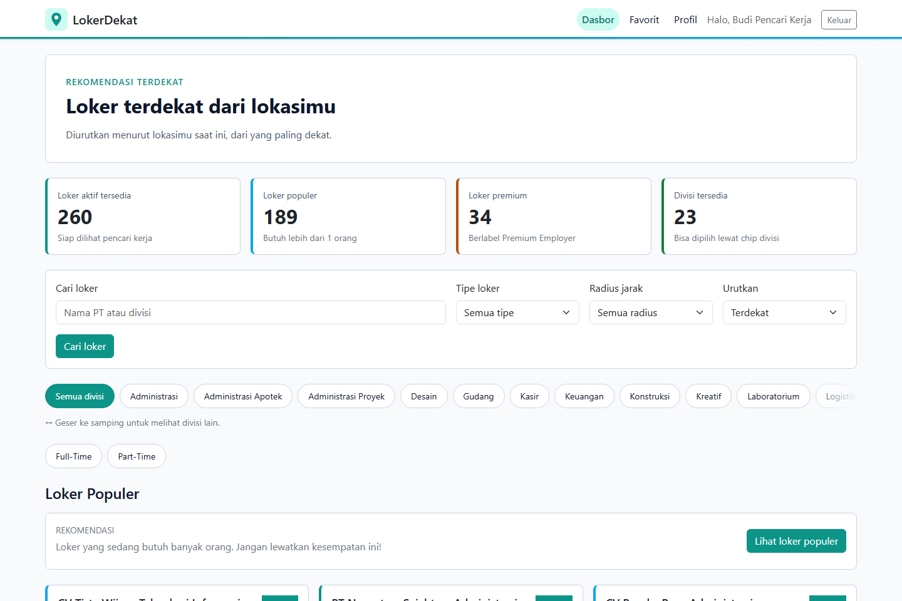](docs/screenshots/dashboard-statistik.png) **3. Statistik & filter (F2, F5)** — jumlah loker aktif, populer, premium, divisi; pencarian, tipe, radius, urutan, dan chip divisi. | [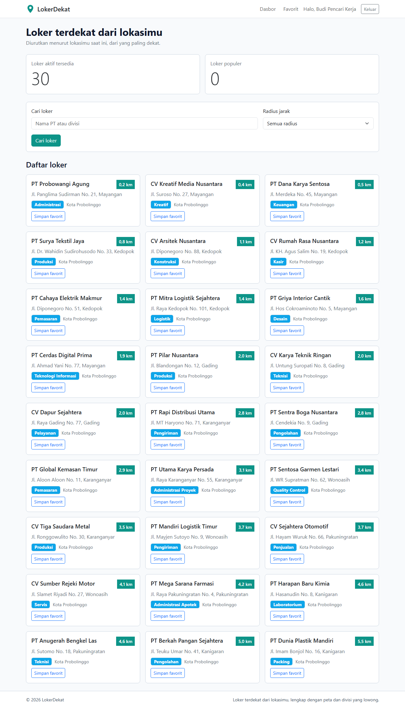](docs/screenshots/dashboard.png) **4. Daftar loker (F2, R1)** — kartu berurutan dari terdekat, memuat nama PT, alamat, divisi, dan jarak km. |
| [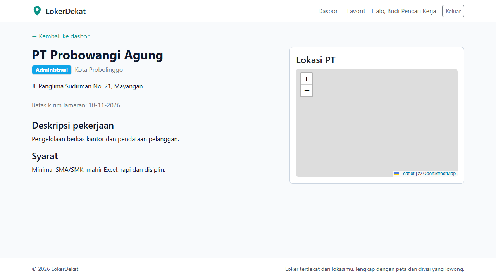](docs/screenshots/detail-loker.png) **5. Detail + peta (F3)** — ringkasan, deskripsi, syarat, peta lokasi PT, dan tombol simpan favorit. | [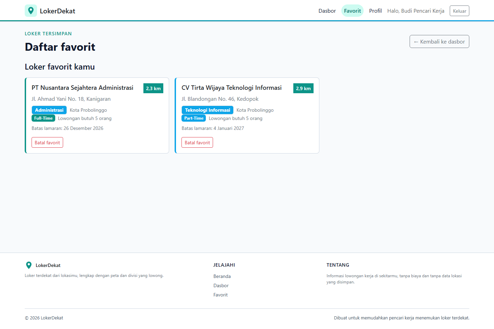](docs/screenshots/favorit.png) **6. Favorit (F6)** — loker yang tersimpan tetap ada setelah keluar dan masuk lagi, lengkap dengan jarak dan aksi batal. |
| [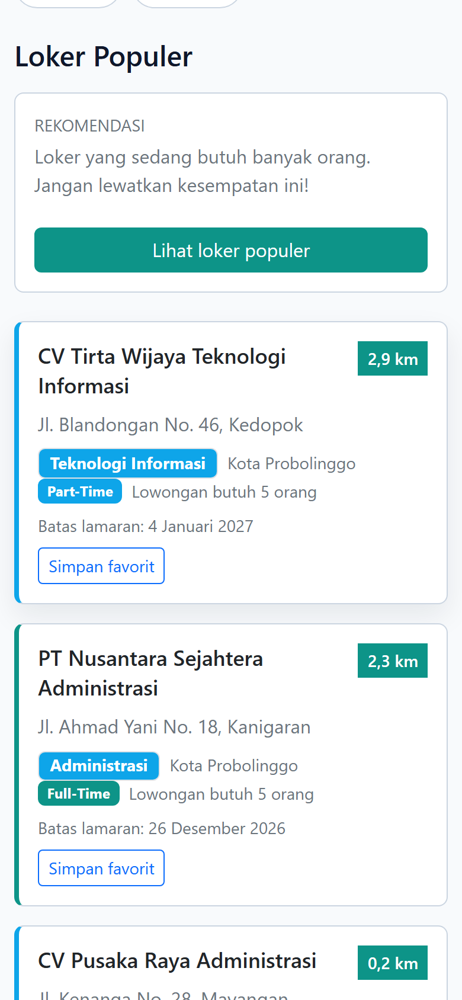](docs/screenshots/dashboard-mobile.png) **7. Tampilan HP** — kartu dan filter menyesuaikan layar sentuh; cocok dipakai dengan izin lokasi. | |

### Antarmuka Pengelola

| | |
|---|---|
| [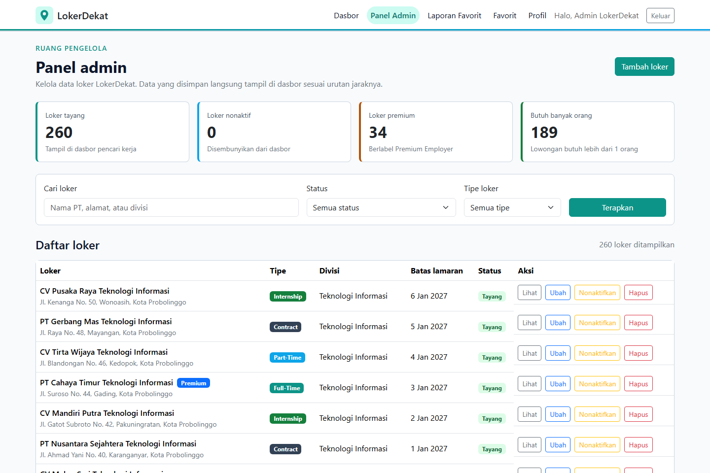](docs/screenshots/admin-panel.png) **1. Panel admin (F4)** — ringkasan loker tayang/nonaktif/premium/butuh banyak orang, filter, dan tabel kelola loker. | [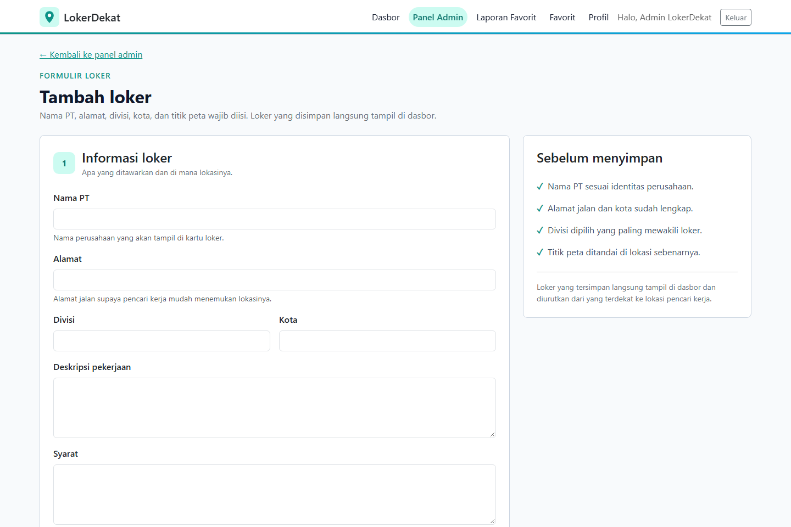](docs/screenshots/admin-form.png) **2. Tambah loker (F4)** — formulir dikelompokkan menjadi bagian bernomor dengan panel panduan. |
| [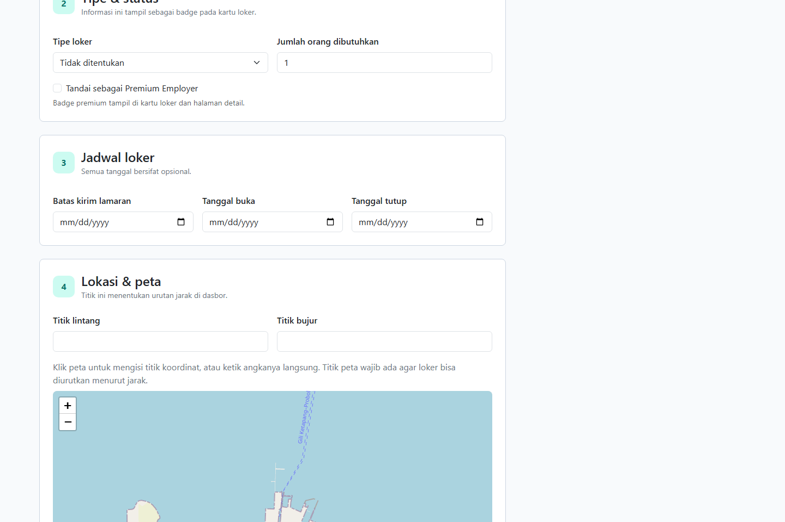](docs/screenshots/admin-form-map.png) **3. Pemilih titik (F4, R2)** — titik lintang/bujur dipilih langsung dari peta; loker tanpa koordinat tidak tayang. | [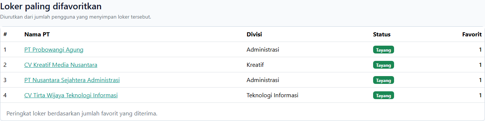](docs/screenshots/admin-favorit.png) **4. Laporan favorit (F4, F6)** — peringkat loker paling difavoritkan (tampilan dibatasi pada data agregat). |

---

## Cara Penggunaan (Singkat)

1. Buka **[https://lokerdekat.rf.gd/loker/](https://lokerdekat.rf.gd/loker/)**, lalu klik **Daftar** atau **Masuk**.
2. Izinkan akses lokasi saat diminta — loker diurutkan dari yang terdekat.
3. Saring dengan kata kunci, tipe, radius, urutan, dan chip divisi; buka kartu untuk melihat peta.
4. Tekan **Simpan favorit** lalu buka menu **Favorit** untuk melihatnya kembali.
5. Admin: masuk lalu buka **Panel Admin** untuk menambah/ubah/nonaktifkan loker dan melihat **Laporan Favorit**.

Akun demo: `pencari@lokerdekat.test` dan `admin@lokerdekat.test` dengan kata sandi `password` (segera ganti lewat menu **Profil**). Langkah lengkap ada di [Panduan Penggunaan](docs/PANDUAN_PENGGUNAAN.md).

---

## Alur Sistem

### Alur Pencari Kerja

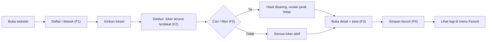

### Alur Pengelola

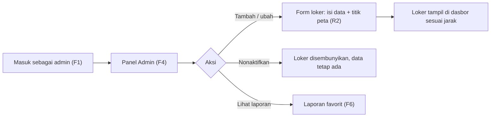

---

## Arsitektur Sistem

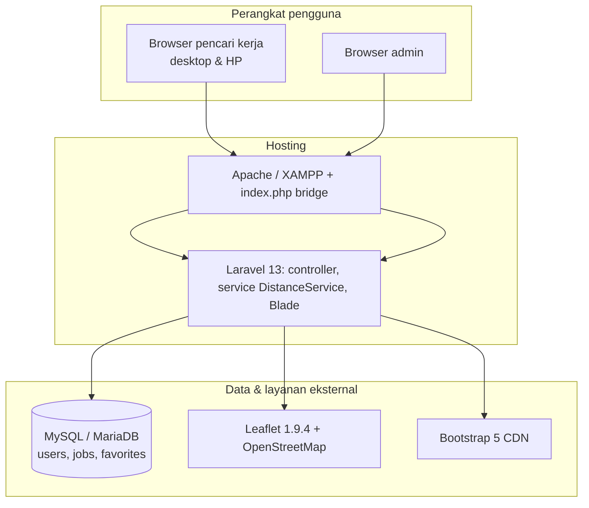

---

## Fitur Aplikasi

| ID | Fitur | Status | Bukti tampilan |
|---|---|---|---|
| `F1` | Masuk dan daftar akun | Selesai | [Masuk](docs/screenshots/login.png) |
| `F2` | Dasbor loker terurut terdekat | Selesai | [Statistik](docs/screenshots/dashboard-statistik.png) · [Daftar](docs/screenshots/dashboard.png) |
| `F3` | Peta dan lokasi loker | Selesai | [Detail + peta](docs/screenshots/detail-loker.png) |
| `F4` | Kelola data loker (admin) | Selesai | [Panel](docs/screenshots/admin-panel.png) · [Form](docs/screenshots/admin-form.png) |
| `F5` | Pencarian dan filter loker | Selesai | [Filter](docs/screenshots/dashboard-statistik.png) |
| `F6` | Simpan loker favorit | Selesai | [Favorit](docs/screenshots/favorit.png) · [Laporan](docs/screenshots/admin-favorit.png) |

---

## Technology Stack

| Kategori | Teknologi | Versi terverifikasi | Fungsi |
|---|---|---|---|
| Backend | Laravel | 13.38.0 | Routing, Form Request, Blade, Eloquent, autentikasi sesi |
| Bahasa | PHP | 8.3.35 | Logika aplikasi dan perhitungan jarak Haversine |
| Database | MySQL / MariaDB | 10.1.32 lokal; 8.0/11.4 hosting | Tabel `users`, `jobs`, `favorites` |
| UI | Bootstrap (CDN) | 5.3.8 | Layout responsif dan komponen |
| Template | Blade | bawaan Laravel | Render halaman server-side |
| Peta | Leaflet + OpenStreetMap | 1.9.4 (aset lokal) | Marker lokasi loker dan peta detail |
| Testing | PHPUnit + Playwright | 12.5.40 / 1.64.1 | 135 tes unit & 4 alur E2E |

---

## Struktur Proyek

```text
loker/
├── AGENTS.md            # pintu masuk agen AI
├── SPEC.json            # sumber kebenaran spesifikasi
├── docs/                # PRD, arsitektur, panduan, screenshot, dan catatan proyek
├── kit/                 # pembangkit paket dokumen
├── app/                 # controller, model, service, middleware Laravel
├── resources/views/     # template Blade
├── database/            # migrasi dan seeder
├── routes/              # definisi rute
├── public/              # aset statis, CSS, dan Leaflet self-host
└── tests/               # tes PHPUnit dan alur E2E Playwright
```

---

## Panduan Instalasi Lokal

1. Pastikan terpasang PHP 8.3, Composer, dan XAMPP (Apache + MySQL).
2. Clone repositori ke folder web, misalnya `C:\xampp\htdocs\loker`.
3. Jalankan `composer install`.
4. Salin `.env.example` menjadi `.env`, lalu `php artisan key:generate`.
5. Nyalakan Apache + MySQL, buat database `db_loker_v2` dengan charset `utf8` (ADR-008).
6. Jalankan `php artisan migrate --seed`.
7. Buka `http://localhost/loker/` lewat Apache, atau `php artisan serve` lalu `http://127.0.0.1:8000`.

Detail deploy publik ada di [DEPLOY.md](DEPLOY.md).

---

## Pengujian & Kualitas Kode

| Tujuan | Perintah | Hasil |
|---|---|---|
| Gaya kode | `vendor/bin/pint --test` | bersih |
| Tes otomatis | `vendor/bin/phpunit` | 135 passed (483 assertions) |
| Alur E2E | `npx playwright test` | 4 passed |
| Build produksi | `composer install --no-dev --optimize-autoloader` | berhasil |

> `php artisan test` tidak tersedia pada Laravel 13.38.0; gunakan `vendor/bin/phpunit`.

---

## Status & Langkah Berikutnya

- **Selesai:** F1–F6, seluruh gerbang kualitas, dan showcase README ini.
- **Live:** `https://lokerdekat.rf.gd/loker/` (InfinityFree, HTTPS).
- **Berikutnya:** pasang pembaruan peta T-056 ke hosting, ganti password akun demo lewat `/profil`, dan cek tautan live dari HP.

---

## Dokumentasi Pendukung

| Dokumen | Fungsi |
|---|---|
| [DEPLOY.md](DEPLOY.md) | Panduan deploy ke hosting publik |
| [docs/PANDUAN_PENGGUNAAN.md](docs/PANDUAN_PENGGUNAAN.md) | Panduan lengkap pencari kerja dan pengelola |
| [docs/PRD.md](docs/PRD.md) | Masalah, tujuan, dan acceptance criteria F1–F6 |
| [docs/ARCHITECTURE.md](docs/ARCHITECTURE.md) | Susunan sistem dan model data |
| [docs/DESIGN_SYSTEM.md](docs/DESIGN_SYSTEM.md) | Warna, tipografi, dan komponen |
| [docs/SECURITY.md](docs/SECURITY.md) | Ancaman dan OWASP 2025 |
| [docs/CODE_STYLE.md](docs/CODE_STYLE.md) | Konvensi penamaan dan commit |
| [docs/TESTING.md](docs/TESTING.md) | Strategi dan checklist pengujian |
| [docs/EVALS.md](docs/EVALS.md) | Gerbang kelayakan lulus |
| [docs/WORKFLOW.md](docs/WORKFLOW.md) | Siklus kerja dan aturan cabang |
| [docs/GUARDRAILS.md](docs/GUARDRAILS.md) | Batas mutlak proyek |
| [docs/TASKS.md](docs/TASKS.md) | Daftar task dan milestone |
| [docs/PROGRESS.md](docs/PROGRESS.md) | Keadaan terakhir proyek |
| [docs/DECISIONS.md](docs/DECISIONS.md) | ADR dan alasan keputusan |
| [docs/LESSONS.md](docs/LESSONS.md) | Kesalahan berulang dan pelajaran |

## License

Proyek ini menggunakan lisensi [MIT License](LICENSE).

## Contributing

Ikuti `docs/WORKFLOW.md`: satu task per cabang, PR kecil, CI hijau, dan review manusia sebelum merge. Pesan commit mengikuti `docs/CODE_STYLE.md` (Conventional Commits). Agen AI bekerja sesuai `AGENTS.md` dan `docs/GUARDRAILS.md`.

## AI Usage Disclosure

Proyek ini disusun dengan bantuan **GitHub Copilot**, termasuk pembuatan paket dokumen awal dari `SPEC.json`. Seluruh perubahan ditinjau dan dipahami penulis sebelum diterima.
