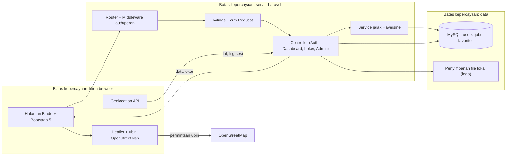

# Architecture: LokerDekat

## Overview

LokerDekat adalah aplikasi web berbasis PHP yang dijalankan di lingkungan lokal XAMPP: Apache melayani halaman, MySQL menyimpan data pengguna, data loker, dan loker favorit, sedangkan Laravel mengatur routing, validasi, autentikasi, dan logika pengurutan jarak. Halaman dirender di sisi server dengan Blade, lalu dirapikan memakai Bootstrap 5 lewat CDN sehingga tidak membutuhkan langkah build berkas aset. Pengguna mengirimkan koordinat lokasi dari browser memakai Geolocation API; server menghitung jarak tiap loker dengan rumus Haversine dan mengurutkannya dari nilai terkecil. Halaman detail menampilkan titik lokasi PT memakai Leaflet dengan ubin OpenStreetMap, dan admin mengelola isi katalog loker lewat rute bertanda middleware peran.

## Tech Stack

| Lapisan | Pilihan | Alasan | Alternatif yang ditolak |
|---|---|---|---|
| Frontend/UI | Blade + Bootstrap 5 via CDN, latest stable (verifikasi: `npm view bootstrap version`) | Sudah dipelajari di kelas (pilihan mahasiswa) | - |
| Backend | Laravel, latest stable (verifikasi: `composer show -a laravel/framework`) | Sudah dipelajari di kelas (pilihan mahasiswa) | - |
| Database | MySQL/MariaDB bawaan XAMPP, latest stable (verifikasi: `mysql --version`) | Sudah dipelajari di kelas (pilihan mahasiswa) | - |
| Auth | Email + password dengan hash bcrypt bawaan Laravel, latest stable (verifikasi: `composer show -a laravel/framework`) | Sudah dipelajari di kelas (pilihan mahasiswa) | - |
| Hosting | localhost XAMPP (Apache + MySQL), latest stable (verifikasi: lihat XAMPP Control Panel) | Sudah dipelajari di kelas (pilihan mahasiswa) | - |
| Testing | PHPUnit (unit) + Playwright (satu alur E2E utama), latest stable (verifikasi: `composer show -a phpunit/phpunit`) | Sudah dipelajari di kelas (pilihan mahasiswa) | - |
| Extra: peta | Leaflet + OpenStreetMap, latest stable (verifikasi: `npm view leaflet version`) | Menampilkan titik lokasi PT tanpa kunci API berbayar | - |
| Extra: penyimpanan file | Penyimpanan file lokal `public/uploads` (logo), latest stable (verifikasi: dokumentasi Laravel Storage) | Menyimpan logo perusahaan yang diunggah admin | - |

Stack dipilih mahasiswa: jangan mengusulkan penggantian stack; ikuti konvensi resmi teknologi ini.

## System Diagram



## Project Structure

```text
loker/                        # root proyek (berisi folder kit/ dan dokumen)
├── AGENTS.md                 # pintu masuk agen AI
├── README.md                 # readme proyek
├── SPEC.json                 # satu sumber kebenaran spesifikasi
├── docs/                     # PRD, ARCHITECTURE, TASKS, dan dokumen lain
├── kit/                      # pembangkit paket dokumen (bukan bagian aplikasi)
├── .github/workflows/ci.yml  # CI GitHub Actions
├── .env.example              # contoh variabel lingkungan tanpa rahasia
├── app/
│   ├── Http/Controllers/     # Auth, Dashboard, Loker, Favorit, Admin
│   ├── Http/Middleware/      # cek peran admin
│   ├── Http/Requests/        # validasi form loker dan registrasi
│   ├── Models/               # User, Job, Favorite
│   └── Services/             # perhitungan jarak Haversine
├── resources/views/          # template Blade (layouts, dashboard, admin)
├── database/migrations/      # skema users, jobs, favorites
├── database/seeders/         # data loker awal
├── routes/web.php            # rute publik, terautentikasi, admin
├── public/                   # berkas statis, index.php, uploads (logo)
└── tests/                    # unit test PHPUnit dan alur E2E Playwright
```

## Data Model

**users**

| Field | Tipe | Keterangan |
|---|---|---|
| id | bigint | kunci utama |
| name | varchar | nama pengguna (data pribadi) |
| email | varchar, unik | email pengguna (data pribadi) |
| password | varchar | hash bcrypt, tidak pernah disimpan polos |
| role | enum | `user` atau `admin` |
| created_at, updated_at | timestamp | bawaan Laravel |

**jobs**

| Field | Tipe | Keterangan |
|---|---|---|
| id | bigint | kunci utama |
| company_name | varchar | nama PT |
| address | varchar | alamat jalan |
| division | varchar | divisi yang lowong |
| city | varchar | kota/daerah loker |
| description | text | deskripsi singkat lowongan |
| requirements | text | syarat calon pelamar |
| deadline | date | batas waktu info, boleh kosong |
| latitude, longitude | decimal(10,7) | titik lokasi untuk urutan jarak |
| is_active | boolean | penanda tayang di dasbor |
| posted_by | bigint | rujukan ke users.id pembuat |
| created_at, updated_at | timestamp | bawaan Laravel |

**favorites**

| Field | Tipe | Keterangan |
|---|---|---|
| id | bigint | kunci utama |
| user_id | bigint | rujukan ke users.id (pasangan unik bersama job_id) |
| job_id | bigint | rujukan ke jobs.id |
| created_at, updated_at | timestamp | bawaan Laravel |

Relasi: satu pengguna memiliki banyak loker yang ia unggah (`users.id → jobs.posted_by`), satu pengguna memiliki banyak loker favorit (`users.id → favorites.user_id`), dan satu loker bisa disimpan oleh banyak pengguna (`jobs.id → favorites.job_id`).

## Data Flow

1. **Urutan loker terdekat (F2, F3).** Halaman dasbor memuat skrip browser yang meminta izin lokasi, lalu mengirim `lat` dan `lng` sebagai parameter permintaan ke controller dashboard. Controller membaca seluruh loker aktif, menghitung jarak memakai service Haversine, mengurutkan menaik, dan mengirim daftar terurut beserta jarak km ke Blade. Bila izin ditolak, controller memakai koordinat default pusat Probolinggo. Validasi terjadi di Form Request untuk parameter pencarian; otorisasi diterapkan pada seluruh rute yang butuh sesi.
2. **Admin menambah loker (F4).** Admin mengirim form lewat POST; Form Request menolak bila nama PT, alamat, divisi, atau koordinat kosong, sehingga loker tidak tersimpan. Bila valid, controller menyimpan baris ke tabel `jobs` beserta `posted_by` dari pengguna login, dan loker langsung terbaca dasbor pada urutan sesuai jaraknya.
3. **Loker favorit (F6).** Pengguna menekan tombol simpan; controller menulis pasangan `user_id` dan `job_id` ke tabel `favorites`. Saat halaman Favorit dibuka, controller mengambil daftar milik pengguna login saja — otorisasi memakai id pengguna dari sesi, bukan dari parameter pengguna.

## External Services

| Layanan | Fungsi | Data yang dikirim | Batas/biaya gratis | Rencana cadangan |
|---|---|---|---|---|
| OpenStreetMap (ubin Leaflet) | menampilkan peta lokasi PT | koordinat tampilan peta | cek paket terbaru | peta gagal dimuat → tampilkan alamat teks tetap terlihat |
| Leaflet (CDN) | pustaka peta di sisi klien | tidak ada data pengguna | cek paket terbaru | unduh berkas Leaflet ke `public/` bila CDN tidak terjangkau |
| Bootstrap 5 (CDN) | gaya antarmuka | tidak ada data pengguna | cek paket terbaru | simpan salinan CSS ke `public/` |

Tidak ada layanan berbayar dan tidak ada API key yang disimpan di repositori.

## Environments and Configuration

| Lingkungan | Perbedaan |
|---|---|
| Lokal | XAMPP Apache + MySQL di komputer pengembang, `APP_ENV=local`, `APP_DEBUG=true`, basis data `db_loker_v2` dengan charset `utf8` (batas indeks MariaDB 10.1, ADR-008) |
| Staging/preview | Salinan basis data dengan data dummy, `APP_DEBUG=false`, dipakai untuk memeriksa tampilan sebelum diserahkan |
| Produksi | Belum ditentukan untuk tugas ini; bila ada, `APP_ENV=production`, `APP_DEBUG=false`, HTTPS aktif |

Variabel lingkungan: `APP_NAME`, `APP_ENV`, `APP_KEY`, `APP_URL`, `DB_CONNECTION`, `DB_HOST`, `DB_PORT`, `DB_DATABASE`, `DB_USERNAME`, `DB_PASSWORD`. Yang bersifat rahasia: `APP_KEY` dan `DB_PASSWORD` — nilainya hanya ada di `.env` lokal, `.env` tidak di-commit, dan `.env.example` berisi nama variabel tanpa nilai rahasia.

## Deployment

Rilis dimulai dari merge ke `main`, lalu CI GitHub Actions menjalankan instalasi, persiapan lingkungan, lint, dan tes; cabang kerja tidak pernah di-push langsung ke `main`. Perintah build dipakai persis seperti tertulis di `SPEC.json` (`composer install --no-dev --optimize-autoloader`) untuk produksi, sedangkan pengembangan lokal memakai `php artisan serve`. Rollback dilakukan dengan mengembalikan commit `main` ke revisi sebelumnya yang terakhir lulus CI, lalu memeriksa kesehatan dengan membuka halaman dasbor dan memastikan daftar loker terurut tampil. Karena hosting produksi belum ditentukan, langkah pertama deployment hanya memverifikasi aplikasi berjalan di localhost XAMPP.

## Platform Notes

Platform pendukung: tidak ada (`meta.secondary_platforms` kosong), sehingga seluruh kebutuhan admin diselesaikan di web yang sama.

- Rendering dilakukan di sisi server dengan Blade agar halaman tetap terbaca tanpa JavaScript; JavaScript hanya untuk pengurutan berbasis lokasi, pencarian, dan peta.
- Pengurutan jarak dihitung di server agar aturan urutan tidak bisa dilewati pengguna lewat manipulasi klien.
- Geolocation API hanya aktif pada origin aman (localhost atau HTTPS); di luar itu permintaan lokasi ditolak browser dan sistem memakai koordinat default.
- Peta memakai Leaflet tanpa kunci API; kegagalan memuat ubin tidak menghalangi pengguna membaca alamat loker.
- Caching: gunakan cache bawaan Laravel untuk daftar loker bila jumlah data tumbuh; untuk ukuran data tugas, muat ulang setiap permintaan masih ringan.
- SEO dimatikan (`seo: false`) karena halaman utama berada di balik login.
- `i18n` dimatikan, seluruh antarmuka berbahasa Indonesia.
- Berkas aset tidak dibangun dengan bundler sehingga deployment cukup menyalin folder proyek.
- Keamanan sesi mengandalkan cookie sesi Laravel dan CSRF token pada setiap form.
- Otorisasi peran dilakukan middleware server, bukan sekadar menyembunyikan tautan.
- Data pribadi yang dikirim saat sesi (koordinat lokasi) tidak disimpan ke basis data.
- Aksesibilitas diperiksa pada halaman dasbor dan form admin sebagai dua halaman utama.

## Constraints and Trade-offs

- Waktu pengerjaan hanya 1 minggu dengan 1 pengembang, sehingga cakupan dipangkas menjadi enam fitur dengan empat berstatus must (lihat PRD), bukan portal loker nasional.
- Pilihan frontend Blade + Bootstrap 5 via CDN menghilangkan langkah build aset — trade-off: penyesuaian tampilan dilakukan lewat kelas CSS tambahan, keputusan ini dicatat di ADR-002.
- Backend Laravel dan basis data MySQL dipakai karena sudah dipelajari di kelas, meski itu berarti menulis logika pengurutan jarak sendiri, lihat ADR-003.
- Autentikasi memakai sesi bawaan Laravel tanpa verifikasi email agar registrasi bisa diuji cepat, konsekuensinya email tidak diverifikasi, lihat ADR-004.
- Hosting berhenti di localhost XAMPP karena tidak ada anggaran dan tidak ada kebutuhan akses publik untuk tugas ini, lihat ADR-005.
- Pengujian dibatasi unit test dan satu alur E2E utama agar selesai dalam satu minggu, dengan level proses dasar, lihat ADR-006.
- Penyimpanan file logo memakai disk lokal sehingga tidak cocok bila nanti pindah ke serverless, tetapi cukup untuk kebutuhan sekarang.
- Penyaringan radius dilakukan di server untuk konsistensi hasil, meski artinya setiap pencarian menghitung ulang jarak seluruh loker aktif.
