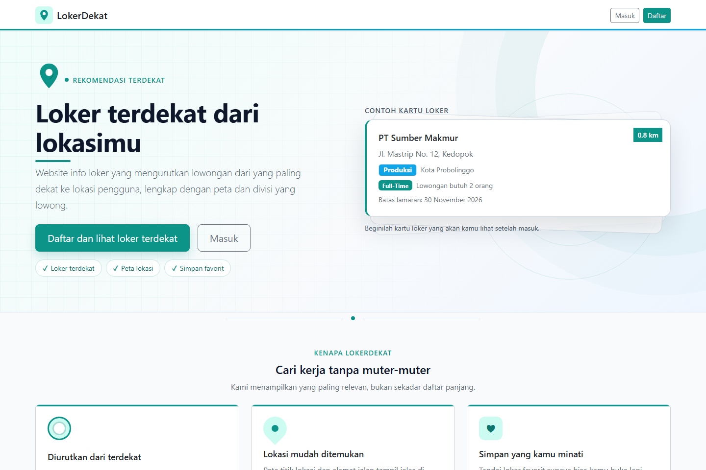
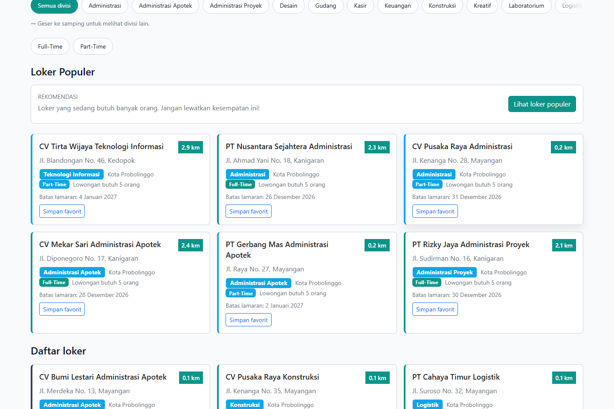
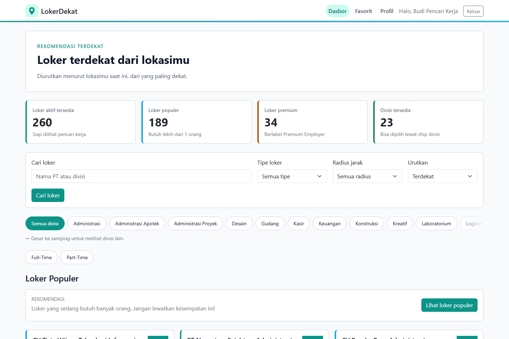
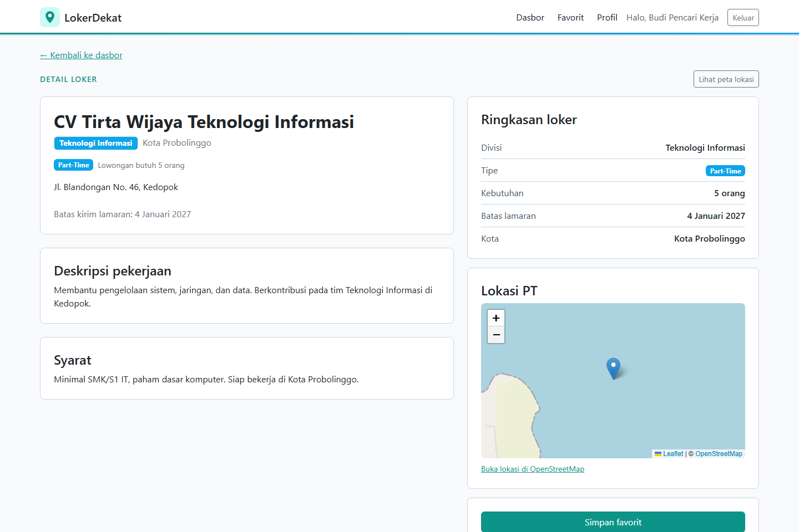
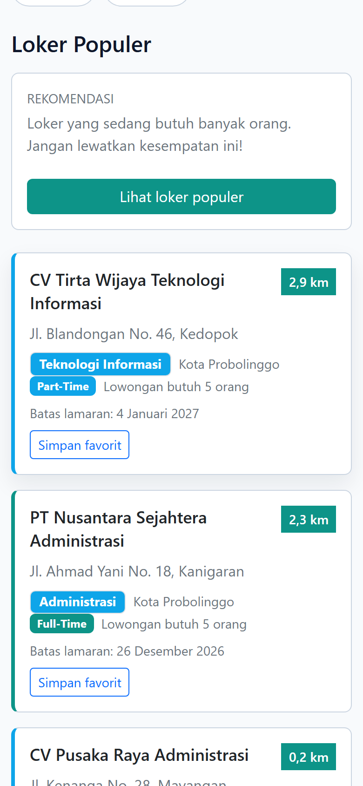

# Panduan Penggunaan LokerDekat

Panduan ini menjelaskan cara memakai website LokerDekat, baik sebagai **pencari kerja** maupun sebagai **pengelola (admin)**. Website dapat dibuka di:

- **Live:** [https://lokerdekat.rf.gd/loker/](https://lokerdekat.rf.gd/loker/)
- **Lokal (XAMPP):** `http://localhost/loker/`

> Seluruh loker di dalam aplikasi adalah **data fiktif** untuk keperluan demonstrasi. Aplikasi ini hanya menyajikan informasi lowongan dan **tidak menyediakan fitur lamaran atau unggah CV**.

## Akun demo

| Peran | Email | Kata sandi |
|---|---|---|
| Admin | `admin@lokerdekat.test` | `password` |
| Pencari kerja | `pencari@lokerdekat.test` | `password` |

Kata sandi di atas diketahui umum. Setelah masuk, segera ganti melalui menu **Profil**.

---

## 1. Untuk pencari kerja

### 1.1 Masuk atau daftar

1. Buka alamat website di browser (laptop atau HP).
2. Halaman depan menampilkan tagline dan tombol **Daftar dan lihat loker terdekat** serta **Masuk**.
3. Klik **Daftar** bila belum punya akun. Isi nama, email, dan kata sandi, lalu kirim.
4. Bila sudah punya akun, klik **Masuk**, isi email dan kata sandi, lalu tekan **Masuk**.
5. Setelah berhasil, browser diarahkan ke halaman **Dasbor**.

### 1.2 Izinkan lokasi agar loker diurutkan dari yang terdekat

1. Saat dasbor dibuka, browser akan meminta izin lokasi. Pilih **Izinkan**.
2. Daftar loker akan diurutkan otomatis dari jarak terkecil, dan angka jarak (km) tampil di setiap kartu.
3. Bila izin ditolak, loker tetap tampil diurutkan dari pusat Kota Probolinggo, disertai pesan pengingat dan tombol **Izinkan lokasi**.

Koordinat lokasi hanya dipakai selama sesi untuk menghitung jarak dan **tidak disimpan ke basis data**.

### 1.3 Memahami kartu loker

Setiap kartu memuat, berurutan:

1. Nama PT di sudut kiri atas dan jarak dalam km di sudut kanan atas.
2. Alamat jalan dan kota.
3. Divisi yang lowong.
4. Badan tipe loker (Full-Time, Part-Time, Contract, atau Internship) dan jumlah orang yang dibutuhkan.
5. Batas lamaran.
6. Tombol **Simpan favorit**.

### 1.4 Mencari dan menyaring loker

Pada bagian atas daftar tersedia:

- **Cari loker** — mengetik nama PT atau divisi; hasil muncul otomatis setelah berhenti mengetik.
- **Tipe loker** — memilih Full-Time, Part-Time, Contract, atau Internship.
- **Radius jarak** — membatasi jarak dari lokasi (1, 5, 10, 25, atau 50 km).
- **Urutkan** — Terdekat, Terbaru, atau Butuh terbanyak.
- **Chip divisi** — pita yang bisa digeser ke samping untuk memilih divisi tertentu.
- **Chip tipe** — pintasan cepat untuk tipe loker.

Tombol **Cari loker** tetap berfungsi bila JavaScript tidak aktif. Filter yang sedang aktif tetap terbawa ketika berpindah halaman daftar loker.

### 1.5 Membuka detail dan peta lokasi

1. Klik judul loker pada kartu (bagian **Loker Populer** atau **Daftar loker**).
2. Halaman detail menampilkan ringkasan loker, deskripsi pekerjaan, syarat, dan peta lokasi PT.
3. Peta memakai Leaflet dengan ubin OpenStreetMap. Bila ubin tidak termuat, alamat loker tetap terbaca sebagai teks biasa di halaman.

### 1.6 Menyimpan dan melihat favorit

1. Tekan **Simpan favorit** pada kartu loker atau pada halaman detail.
2. Buka menu **Favorit** di navbar untuk melihat seluruh loker yang tersimpan.
3. Pada daftar favorit, tekan **Batal favorit** bila ingin menghapusnya.
4. Favorit tetap tersimpan setelah keluar dan masuk lagi, dan hanya milik akun yang bersangkutan yang tampil.

### 1.7 Mengubah profil

1. Buka menu **Profil** di navbar.
2. Ubah nama atau email, lalu simpan. Email harus unik.
3. Untuk mengganti kata sandi, isi kata sandi lama, kata sandi baru (minimal 8 karakter), dan konfirmasinya.
4. Tekan **Keluar** di navbar bila ingin mengakhiri sesi.

### 1.8 Tampilan di HP

Buka website di browser HP, izinkan lokasi, lalu gunakan menu **Share → Add to Home Screen** bila ingin membukanya dengan sekali ketuk. Dasbor dan kartu loker menyesuaikan lebar layar.

---

## 2. Untuk pengelola (admin)

Seluruh halaman admin berada di awalan `/admin` dan dilindungi middleware `auth` + `admin`. Pengguna biasa yang membuka alamat admin akan dialihkan ke dasbor; tamu dialihkan ke halaman **Masuk**.

### 2.1 Membuka panel admin

1. Masuk memakai akun admin (`admin@lokerdekat.test`).
2. Klik **Panel Admin** di navbar.
3. Panel menampilkan kartu ringkasan: jumlah loker tayang, nonaktif, premium, dan butuh banyak orang.

### 2.2 Menambah loker baru

1. Klik **Tambah loker**.
2. Isi formulir sesuai urutan bagian:
   - **Informasi loker**: nama PT, alamat, divisi, kota, tipe loker, jumlah orang dibutuhkan, dan status Premium Employer.
   - **Jadwal loker**: tanggal buka, tanggal tutup, dan batas lamaran.
   - **Lokasi & peta**: titik lintang dan bujur; titik dapat dipilih langsung dengan mengklik peta.
3. Tekan **Simpan**. Nama PT, alamat, divisi, kota, dan koordinat wajib diisi.
4. Loker tanpa koordinat tidak akan ditayangkan di dasbor (aturan R2).

### 2.3 Mengubah, menonaktifkan, atau menghapus loker

1. Pada tabel panel, gunakan filter kata kunci, status, dan tipe untuk mencari loker.
2. Klik **Ubah** untuk mengubah data; klik **Lihat** untuk membuka detail loker.
3. Klik **Nonaktifkan** bila loker tidak ingin ditayangkan. Datanya tetap tersimpan dan dapat diaktifkan kembali dengan tombol **Aktifkan**.
4. Klik **Hapus** untuk menghapus data loker. Lakukan ini hanya bila data memang tidak diperlukan lagi.

### 2.4 Laporan favorit

1. Buka menu **Laporan Favorit** di navbar (hanya admin).
2. Halaman menampilkan peringkat loker yang paling banyak difavoritkan dan rincian favorit per pengguna (nama, email, dan judul loker).
3. Laporan bersifat baca-saja dan diambil dari data favorit yang sudah ada.

---

## 3. Pertanyaan yang sering ditanyakan

| Pertanyaan | Jawaban |
|---|---|
| Apakah aplikasi ini berbayar? | Tidak. Seluruh fitur dapat digunakan tanpa biaya. |
| Apakah lokasi saya disimpan? | Tidak. Koordinat hanya dipakai saat sesi untuk menghitung jarak. |
| Bisakah saya melamar langsung? | Belum. LokerDekat hanya menyajikan informasi dan peta lokasi lowongan. |
| Apakah data loker ini nyata? | Tidak. Semua nama PT dan alamat adalah data fiktif hasil seeder untuk demonstrasi. |
| Loker saya tidak muncul di dasbor? | Pastikan loker berstatus aktif, memiliki koordinat, dan batas lamarannya belum lewat. |

## 4. Butuh bantuan teknis?

Untuk cara menjalankan proyek secara lokal atau deploy, lihat [README.md](../README.md) dan [DEPLOY.md](DEPLOY.md).
